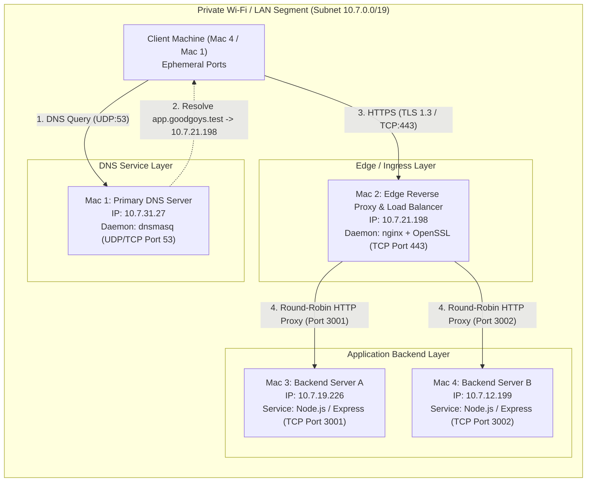
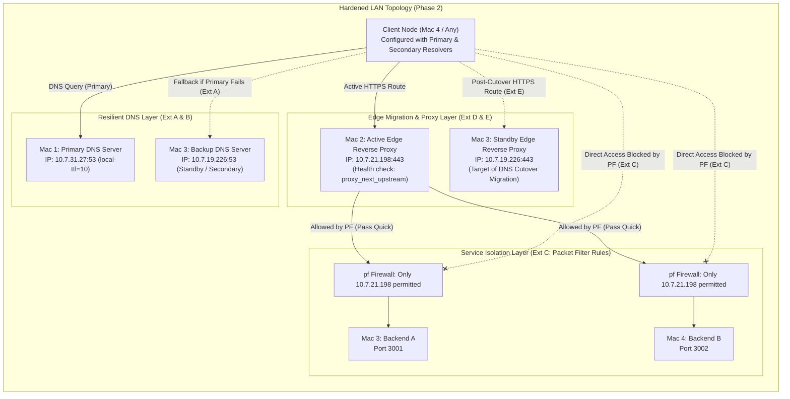
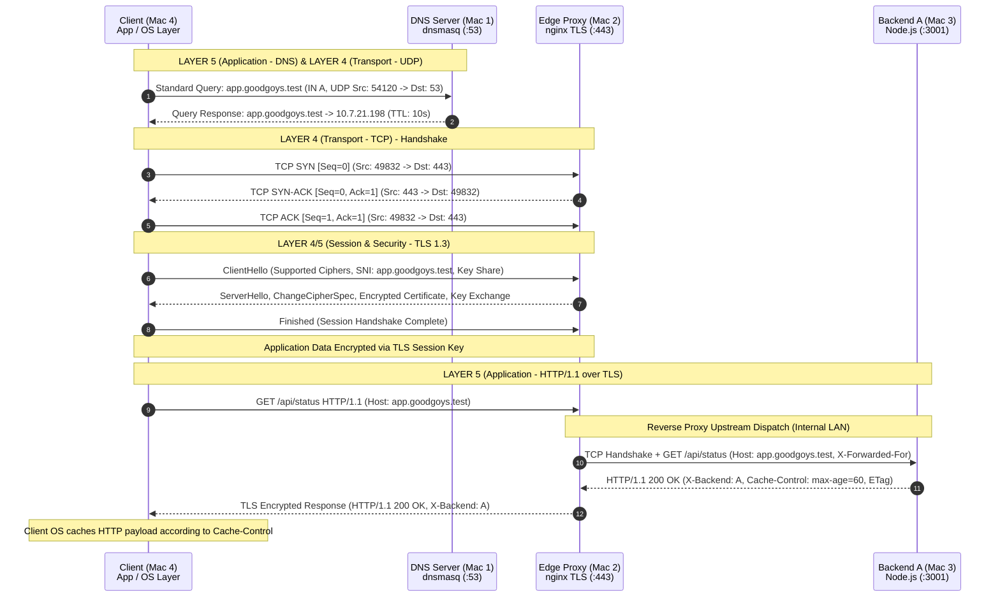

# Architecture Document: Private Network Service Platform
**Course Project: Computer Networks**  
**Team Namespace:** `goodgoys` (`app.goodgoys.test` / `api.goodgoys.test`)  
**Status:** Updated for Phase 2 (Harden, Recover, and Troubleshoot)

---

## 1. Network Topology Diagram

The infrastructure runs entirely on an isolated local area network across up to four physical macOS nodes. Clients access all services through private domain names managed by custom authoritative DNS resolvers.

### 1.1 Phase 1 Baseline Topology
In Phase 1, Mac 2 acts as the single edge gateway terminating TLS and balancing requests between Backend A and Backend B:

---

### 1.2 Phase 2 Hardened Topology (Resilience, Isolation & Failover)
In Phase 2, the network adds a **secondary backup DNS resolver**, **packet-filter service isolation**, an **Nginx upstream health failover**, and a **standby edge proxy** for live DNS migration:

---

## 2. Machine Roles and IP / Service Inventory Table

| Node | Physical Machine | Phase 1 Primary Role | Phase 2 Extended Capabilities | IPv4 Address | Active Ports | Underlying Daemons / Tools | Cloud Infrastructure Analog |
| :--- | :--- | :--- | :--- | :--- | :--- | :--- | :--- |
| **Mac 1** | Primary Infrastructure | Authoritative DNS Server | Primary DNS with configurable TTL (`local-ttl=10`) & DNS Cutover controller | `10.7.31.27` | UDP `53` TCP `53` | `dnsmasq`, macOS networking | AWS Route 53 / Google Cloud DNS |
| **Mac 2** | Edge Node | Reverse Proxy & Round-Robin Load Balancer | TLS termination, Active failover (`proxy_next_upstream`, `fail_timeout=5s`) | `10.7.21.198` | TCP `443` TCP `80` (redirect) | Nginx 1.25+, OpenSSL 3.x, macOS PKI | AWS Application Load Balancer (ALB) / Cloudflare Edge |
| **Mac 3** | App Server A | Backend REST Instance A (`X-Backend: A`) | **1.** Backup DNS Resolver (Ext A) **2.** `pf` Service Isolation (Ext C) **3.** Standby Edge Proxy (Ext E) | `10.7.19.226` | TCP `3001` (Backend) UDP `53` (Backup DNS) TCP `443` (Standby Edge) | Node.js v20+, Express, `dnsmasq`, `pfctl` (BSD Packet Filter) | EC2 Instance A / Standby Multi-AZ Ingress Gateway |
| **Mac 4** | App Server B & Client | Backend REST Instance B (`X-Backend: B`) | Verification Client, Wireshark Packet Sniffer, Automated Failover Tester | `10.7.12.199` | TCP `3002` (Backend) Ephemeral client ports | Node.js v20+, Express, `curl`, `dig`, Wireshark / `tcpdump` | EC2 Instance B / VPC Test Consumer Client |

---

## 3. End-to-End Request Flow Diagram by Protocol Layer

Every client transaction traverses all five layers of the TCP/IP stack across multiple network boundaries.

---

## 4. Layer-by-Layer Protocol Mapping Table

| Stack Layer | Protocol | Encapsulation & Packet Identifiers | Concrete Implementation in this System | Observation & Diagnostic Tool |
| :--- | :--- | :--- | :--- | :--- |
| **Layer 5 (Application)** | **DNS** | UDP Payload, Port `53`, A Record mapping name to IPv4 address | `dnsmasq` authoritative mapping for `*.goodgoys.test` | `dig @10.7.31.27 app.goodgoys.test +short` |
| **Layer 5 (Application)** | **HTTP/1.1** | Headers: `Host`, `X-Backend`, `Cache-Control`, `ETag`, Status Code | Express REST endpoints on Backends A & B; proxied by Nginx | `curl -i https://app.goodgoys.test/api/status` |
| **Layer 4 / 5 (Security / Session)** | **TLS 1.3** | Handshake records: `ClientHello`, `ServerHello`, Certificate Exchange, Encrypted Application Data | Nginx TLS termination with RSA/ECDSA cert issued by local CA (`mkcert`) | `openssl s_client -connect 10.7.21.198:443 -servername app.goodgoys.test` |
| **Layer 4 (Transport)** | **TCP & UDP** | TCP 3-way handshake (`SYN`, `SYN-ACK`, `ACK`), Ephemeral client ports (e.g. `51234`), Destination ports `53`, `443`, `3001`, `3002` | Kernel TCP/IP stack; socket pairs `(SrcIP:SrcPort, DstIP:DstPort)` | Wireshark filter: `tcp.port == 443 \|\| udp.port == 53` |
| **Layer 3 (Network)** | **IPv4** | Source & Destination IP addresses, TTL packet counter, Subnet routing (`10.7.0.0/19`) | LAN private routing across macOS Wi-Fi interfaces (`en0`) | `ping -c 3 10.7.21.198` `netstat -rn` |
| **Layer 2 (Data Link)** | **Ethernet / 802.11** | Source & Destination MAC addresses (hardware framing) | Physical Wi-Fi frame transfer over local access point | `arp -a` `tcpdump -e -i en0` |

---

## 5. Phase 2 Hardening Extensions Summary

### 5.1 Extension A: Resilient Secondary DNS
- Primary DNS (`10.7.31.27`) and Secondary DNS (`10.7.19.226`) run identical records.
- If Primary DNS ceases operation, client resolver falls back to Secondary DNS without interrupting application availability.

### 5.2 Extension B: DNS Cache Governance & Controlled Change
- DNS responses are pinned to a short, visible TTL (`local-ttl=10` or `30`).
- Cache retention is observable on client resolvers prior to expiry, and manual cache invalidation is executed with `dscacheutil -flushcache; killall -HUP mDNSResponder`.

### 5.3 Extension C: Service Isolation via Packet Filter (`pf`)
- Backends (`3001`, `3002`) enforce zero-trust boundary rules.
- Rule: `pass in quick proto tcp from 10.7.21.198 to any port 3001` followed by `block in proto tcp to any port 3001`.
- Direct client access to backend instances is dropped at the link/transport layer; all queries must traverse the authenticated TLS edge proxy.

### 5.4 Extension D: Upstream Active Failover
- Nginx upstream definition uses `max_fails=1 fail_timeout=5s` and `proxy_next_upstream error timeout http_502`.
- When Backend A halts, requests route to Backend B transparently with zero client-perceived HTTP 502 errors.

### 5.5 Extension E: Zero-Downtime Edge Migration
- Standby Nginx reverse proxy configured on Mac 3 (`10.7.19.226`).
- Authoritative DNS record modified to switch `app.goodgoys.test` from Mac 2 to Mac 3.
- Transition displays zero dropped requests as client resolvers switch over upon TTL expiration.
